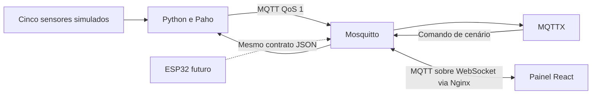

# Smart Environment

Simulação de uma sala monitorada por Internet das Coisas para a disciplina TP546.
Cinco sensores Python publicam temperatura, umidade, CO₂, luminosidade e presença
em um broker Mosquitto. Um painel React permite acompanhar os dados, os alertas e
o estado do dispositivo, além de mudar o cenário durante a demonstração.

> [!NOTE]
> As leituras são sintéticas. O projeto demonstra comunicação e processamento IoT.
> A implementação física está documentada separadamente e ainda não foi validada.

## Início rápido

Pré-requisitos: Docker Engine e Docker Compose v2. Para o desenvolvimento local,
instale também [uv](https://docs.astral.sh/uv/getting-started/installation/) e Python
3.12. O caminho abaixo parte da raiz deste repositório.

```bash
cd project/project_iot
cp .env.example .env
docker compose up --build -d
```

Abra **http://localhost:3000** para visualizar o painel. Os dados são atualizados
automaticamente, com cartões dos cinco sensores, gráfico das últimas 60 leituras,
alertas e seleção dos seis cenários. A presença aparece no resumo da sala.
O painel distingue dados antigos, dispositivo offline e falha de conexão;
mudanças de cenário são confirmadas pela próxima telemetria do simulador.
O histórico fica apenas na memória da aba e reinicia ao recarregar a página.

O dashboard usa tema escuro, com CO₂ em destaque, resumo das condições da sala,
status MQTT separado do estado do dispositivo e indicação LIVE apenas com dados
atuais. Os gráficos permitem selecionar a métrica, inspecionar leituras por
mouse, toque ou teclado e consultar uma tabela acessível. A interface inclui
skeletons de carregamento, alertas ativos e eventos de presença e cenário.

Por padrão, somente a porta 3000 é publicada no computador. O broker usa as
portas 1883 e 9001 apenas dentro do Docker, evitando conflitos com um Mosquitto
ou outro serviço já instalado. Não é necessário apagar imagens ou volumes.

Para acessar o broker a partir do computador (MQTTX, Python local ou Vite),
habilite explicitamente as portas:

```bash
docker compose -f docker-compose.yml -f compose.host-ports.yaml up --build -d
```

Se houver conflito nesse modo opcional, ajuste `MQTT_PORT` e `MQTT_WS_PORT` no
`.env` para portas livres. Esses valores não afetam a comunicação interna.

Opcionalmente, abra o [MQTTX Desktop](https://mqttx.app/), crie uma conexão MQTT 3.1.1 com host
`localhost`, porta `1883`, sem TLS e sem autenticação, e assine
`iot/environment/room01/#` com QoS 1. Use um client ID diferente de
`simulator-room01`. Os dados são enviados a cada cinco segundos.

```bash
docker compose ps
docker compose logs --tail=20 sensor-simulator
```

O guia [dashboard/mqttx.md](dashboard/mqttx.md) descreve a demonstração pelo MQTTX,
que continua disponível como ferramenta auxiliar.

### Acompanhar o Mosquitto e as publicações pelo Docker

Execute os comandos abaixo dentro de `project/project_iot`. Para conferir os
serviços e as portas publicadas:

```bash
docker compose ps
```

Para acompanhar os logs do broker e os registros de publicação do simulador:

```bash
docker compose logs --tail=30 -f mosquitto sensor-simulator
```

Os logs do Mosquitto mostram conexões, desconexões e erros conforme a configuração
do broker. Os registros `sample_published` do simulador informam cenário, CO₂ e
alertas ativos. Para ver o tópico e o JSON completo de cada mensagem, abra outro
terminal e execute um assinante dentro do próprio contêiner:

```bash
docker compose exec mosquitto mosquitto_sub \
  -h localhost \
  -p 1883 \
  -t 'iot/environment/room01/#' \
  -q 1 \
  -v
```

O `-v` exibe o tópico junto do payload. A assinatura recebe `telemetry`, `alerts`,
`status` e eventuais `commands`. As últimas mensagens retidas aparecem imediatamente,
seguidas das novas publicações. Confira o timestamp e o status para distinguir
uma leitura antiga de um dispositivo conectado. Para receber somente as leituras,
troque o tópico por `iot/environment/room01/telemetry`. Se alterar `TOPIC_PREFIX`
ou `DEVICE_ID`, ajuste a assinatura. Encerre o acompanhamento com **Ctrl+C**.

Nesse comando, `localhost:1883` aponta para o próprio contêiner Mosquitto. Não é
necessário habilitar `compose.host-ports.yaml`. No Compose padrão, `1883/tcp` em
`docker compose ps` indica a porta interna, enquanto `127.0.0.1:3000->80/tcp`
indica a porta do painel publicada no computador. O acesso externo por MQTTX ou
Python local exige o arquivo opcional de portas descrito no início deste guia.

Conexões curtas e periódicas do cliente `mosquitto_pub` também podem aparecer nos
logs: o healthcheck do broker publica em `health/broker` a cada cinco segundos.
Essas mensagens ficam fora do prefixo `iot/environment/room01/#`.

O Mosquitto não possui painel web próprio. A interface gráfica deste projeto é o
frontend React em **http://localhost:3000**, conectado ao broker por MQTT sobre
WebSocket via Nginx no caminho `/mqtt`.

### Desenvolvimento do frontend

Com Node.js 22.12+ e npm instalados, deixe broker e simulador rodando no Docker
e pare o frontend Docker para liberar a porta 3000:

```bash
docker compose -f docker-compose.yml -f compose.host-ports.yaml up --build -d mosquitto sensor-simulator
docker compose stop frontend
cd frontend
npm ci
npm run dev
```

Abra http://localhost:3000. O Vite encaminha `/mqtt` ao WebSocket do broker em
`127.0.0.1:9001`; o Nginx faz o mesmo na execução Docker, usando a rede interna.
O frontend lê `DEVICE_ID`, `TOPIC_PREFIX`, `PUBLISH_INTERVAL` e `MQTT_WS_PORT` do
arquivo `project_iot/.env` no desenvolvimento. No Docker, os três primeiros são
argumentos de build, então execute `docker compose up --build -d` após alterá-los.
`FRONTEND_PORT` muda a porta do painel Docker, e `MQTT_WS_PORT` muda a porta local
do broker WebSocket no modo opcional com `compose.host-ports.yaml`. Ambas são
publicadas somente em `127.0.0.1`.

Verificações do frontend, dentro de `frontend/`:

```bash
npm test
npm run build
```

## Arquitetura



O simulador e o broker ficam na rede Docker `iot-network`. Dentro dela, o broker
é `mosquitto:1883`. O acesso ao broker pelo computador é opcional, habilitado
por `compose.host-ports.yaml`.
O Compose aguarda o healthcheck do broker antes de iniciar o simulador.

```text
project_iot/
├── src/common/             # Configuração, contratos e logs
├── src/simulator/          # Sensores, cenários, alertas e transporte MQTT
├── src/physical/esp32/     # Especificação de integração física
├── mqtt/config/           # Configuração do Mosquitto
├── dashboard/             # Guia de visualização no MQTTX
├── frontend/              # Painel React, testes e Nginx
├── tests/                 # Testes unitários e integração MQTT real
├── docs/                  # Arquitetura, hardware, mercado e demonstração
├── presentation/          # PowerPoint e fonte para regeneração
├── docker-compose.yml
├── Dockerfile
├── Makefile
├── pyproject.toml
└── uv.lock
```

Detalhes em [arquitetura](docs/architecture.md) e [contrato MQTT](docs/mqtt-contract.md).

## Python e uv

`pyproject.toml` define metadados, dependências, grupos e ferramentas.
`uv.lock` fixa as versões resolvidas das dependências. A série Python 3.12 é
definida por `requires-python = ">=3.12,<3.13"` no próprio `pyproject.toml`.
`uv` gerencia Python, ambientes e dependências. O versionamento do código continua
sendo feito pelo Git. Não é necessário manter um `requirements.txt` paralelo.

Para executar no computador, deixe apenas o broker no Docker, evitando dois
simuladores com o mesmo ID:

```bash
uv sync --locked
docker compose stop sensor-simulator
docker compose -f docker-compose.yml -f compose.host-ports.yaml up -d mosquitto
uv run --locked --env-file .env iot-simulator
```

O comando equivalente é `uv run --locked --env-file .env python -m simulator.main`.
Também é possível usar um broker Mosquitto já instalado e executar somente o último
comando. Encerre com Ctrl+C.

## Configuração

Copie `.env.example` para `.env`. O Compose lê esse arquivo automaticamente.
Na execução local, passe `--env-file .env` ao `uv run`.

| Variável | Padrão | Função |
|---|---|---|
| `MQTT_HOST` | `localhost` | Broker na execução local. Compose fixa `mosquitto` |
| `MQTT_PORT` | `1883` | Porta local. Dentro do Compose, o broker usa 1883 |
| `MQTT_BIND_ADDRESS` | `127.0.0.1` | Interface do computador exposta pelo Compose |
| `DEVICE_ID` | `room01` | Identificador único e segmento do tópico |
| `TOPIC_PREFIX` | `iot/environment` | Prefixo compartilhado |
| `PUBLISH_INTERVAL` | `5` | Intervalo em segundos, maior que zero |
| `SCENARIO` | `normal` | Cenário inicial |
| `RANDOM_SEED` | `42` | Reprodutibilidade dos valores simulados |
| `CO2_THRESHOLD` / `CO2_HYSTERESIS` | `1500` / `100` | Alerta e margem de recuperação, em ppm |
| `TEMPERATURE_THRESHOLD` / `TEMPERATURE_HYSTERESIS` | `30` / `1` | Limite superior e margem, em °C |
| `HUMIDITY_LOW` / `HUMIDITY_HIGH` | `30` / `70` | Limites de umidade relativa, em % |
| `HUMIDITY_HYSTERESIS` | `3` | Margem de recuperação em pontos percentuais |
| `LIGHT_THRESHOLD` / `LIGHT_HYSTERESIS` | `200` / `20` | Limite inferior e margem, em lux |

Configurações inválidas causam encerramento com código 2 e identificação dos
campos nos logs. Para um broker externo, o cliente Python também aceita
`MQTT_USERNAME`, `MQTT_PASSWORD`, `MQTT_TLS` e `MQTT_CA_FILE`. Isso não habilita
autenticação ou TLS no broker Compose, que precisa de configuração própria.

## Cenários e sensores

| Cenário | Comportamento |
|---|---|
| `normal` | Ocupação alternada em blocos de 60 s e CO₂ moderado |
| `crowded` | Presença contínua, temperatura, umidade e CO₂ crescentes |
| `empty` | Sem presença, CO₂ converge para 450 ppm |
| `poor_ventilation` | Presença contínua, CO₂ converge para 2400 ppm |
| `high_temperature` | Temperatura converge para 31,5 °C |
| `night` | Sem presença, baixa luminosidade e CO₂ decrescente |

Os sensores têm estado próprio, limites, ruído pequeno e transições suaves.
O modelo é uma resposta de primeira ordem a valores-alvo. Não é um modelo físico
calibrado de ventilação. A mesma semente reproduz valores para os mesmos passos de
tempo, mas timestamps e pequenas diferenças de agendamento variam entre execuções.

Para mudar o cenário pelo MQTTX, publique em
`iot/environment/room01/commands`, com QoS 1 e **Retain desligado**:

```json
{"scenario": "poor_ventilation"}
```

Depois publique `{"scenario":"empty"}` para mostrar a recuperação sem reiniciar
os sensores. Para alterar o cenário inicial pelo terminal:

```bash
SCENARIO=poor_ventilation docker compose up -d sensor-simulator
```

`docker compose restart` não aplica variáveis alteradas. Use `up -d` para recriar
o serviço quando mudar `.env`.

## MQTT e alertas

| Tópico | Conteúdo | QoS | Retenção |
|---|---|---|---|
| `iot/environment/room01/telemetry` | Última leitura JSON | 1 | Sim |
| `iot/environment/room01/alerts` | Conjunto completo de alertas ativos | 1 | Sim |
| `iot/environment/room01/status` | `online` ou `offline` | 1 | Sim |
| `iot/environment/room01/commands` | Mudança de cenário | 1 | Não |

O contrato inclui versão, dispositivo, horário UTC, origem e unidades documentadas.
O conjunto vazio `"active":[]` limpa alertas anteriores. O alerta de CO₂ ativa acima
de 1500 ppm e persiste enquanto a leitura estiver acima de 1400 ppm. Luminosidade
baixa só gera alerta com presença. Veja a
[justificativa dos limiares](docs/architecture.md#limiares-e-limitações).

Paho tenta reconectar automaticamente, inclusive se o broker estiver ausente no
início. O Last Will publica `offline` em desconexões inesperadas. O simulador
continua evoluindo durante a queda, sem armazenar um histórico local de leituras
perdidas. QoS 1 admite duplicatas. Uma publicação em trânsito pode ser reenviada
após reconexão. Use o timestamp para distinguir leituras antigas.

## Testes e manutenção

```bash
make test
make lint
```

Os testes de integração exigem um broker real acessível em `MQTT_HOST:MQTT_PORT`:

```bash
docker compose -f docker-compose.yml -f compose.host-ports.yaml up -d mosquitto
make integration
```

Para rodar toda a suíte com integração habilitada:

```bash
RUN_MQTT_TESTS=1 uv run --locked pytest
```

Os testes usam IDs exclusivos e limpam seus tópicos retidos em `iot/tests`.
O [plano de testes](docs/testing.md) inclui queda do broker e demonstração manual.

| Comando | Ação |
|---|---|
| `make up` | Construir e iniciar serviços em segundo plano |
| `make down` | Parar serviços, preservando dados do broker |
| `make logs` | Acompanhar todos os logs |
| `make mqtt-logs` | Acompanhar o broker |
| `make simulator-logs` | Acompanhar o simulador |
| `make restart` | Reiniciar com a configuração atual |
| `make sync` | Sincronizar o ambiente com o lockfile |
| `make run` | Executar localmente usando `.env` |
| `make presentation` | Regenerar o PPTX usando o grupo `presentation` |

## Hardware e material da entrega

- [Integração ESP32](src/physical/esp32/integration.md), com fluxo de firmware e pinagem.
- [Componentes e montagem](docs/hardware.md).
- [Mercado e viabilidade](docs/market.md), com fontes e limites da estimativa.
- [Apresentação PowerPoint](presentation/smart-environment.pptx).
- [Checklist de entrega](docs/delivery.md).

## Segurança e privacidade

O broker de demonstração aceita conexões anônimas e expõe apenas o loopback por
padrão. Para um ESP32 em outro computador/rede, configure conscientemente a
interface, firewall, autenticação, ACL por dispositivo e TLS. Não exponha esta
configuração anônima diretamente à Internet. Credenciais devem ficar fora do Git.

O PIR detecta movimento, sem câmera ou identidade, mas isso não equivale a medir
ocupação com precisão. Até registros de presença agregados exigem uma política de
acesso e retenção em uma implantação real.

## Licença

Este diretório segue a [licença MIT do repositório](../../LICENSE).
