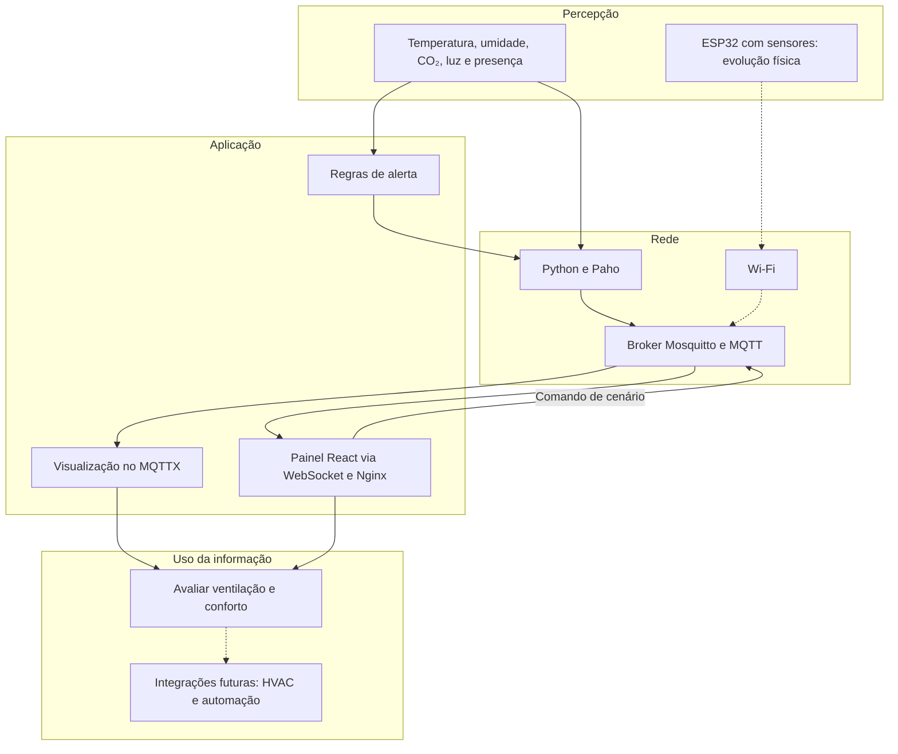

# Arquitetura e limites

O objetivo é transformar leituras ambientais em informação observável e alertas
configuráveis para salas de aula, laboratórios e escritórios. Esta versão valida
o fluxo por software. Uma implantação em clínicas ou indústrias exigiria avaliação
própria dos requisitos, calibração e condições de uso.

## Camadas IoT

No simulador, os alertas são calculados antes da publicação. Um futuro dispositivo
físico pode executar regras equivalentes ou delegá-las a um subscriber central.
Não existe atuação automática na versão atual.

O painel React é servido em `http://localhost:3000` pelo Compose. O Nginx encaminha
`/mqtt` ao listener WebSocket do Mosquitto, na porta interna 9001. O Compose padrão
publica somente a porta do frontend. No desenvolvimento, `compose.host-ports.yaml`
publica as portas MQTT no computador e o Vite usa o WebSocket no loopback. Não há API intermediária
nem persistência adicional: o gráfico mantém até 60 leituras recebidas nesta aba.
Alertas são correlacionados com a telemetria pelo timestamp, e comandos de cenário
usam QoS 1 sem retenção; a próxima telemetria confirma a mudança.

## Modelo de simulação

Cada sensor numérico mantém seu estado. A cada passo, aproxima-se do alvo do
cenário por uma resposta exponencial, com ruído pequeno, limites de faixa e de
taxa de mudança. Temperatura e umidade respondem mais lentamente que luz. CO₂
sobe em cenários ocupados com baixa ventilação e cai em `empty`.

As correlações decorrem dos alvos do cenário. Volume da sala, vazão de ar, número
exato de ocupantes e geração metabólica não são modelados. O cenário permite
demonstrar o processamento, mas não prever o CO₂ de uma sala real.

## Limiares e limitações

A [HSE](https://www.hse.gov.uk/ventilation/using-co2-monitors.htm) orienta que níveis
consistentemente superiores a 1500 ppm em sala ocupada indicam ventilação
inadequada. O projeto usa 1500 ppm como gatilho didático e 100 ppm de histerese.
O código avalia cada amostra, sem confirmar persistência temporal. Logo, o alerta
não reproduz integralmente a avaliação recomendada pela fonte. Não se trata de
limite clínico, norma brasileira ou índice completo de qualidade do ar.

Os limites de temperatura, umidade e luz são configurações demonstrativas,
não recomendações normativas. Em campo, devem ser definidos pelo uso do ambiente
e pela regulamentação aplicável. Não foram avaliados produtividade, saúde ou
economia de energia. Esses benefícios são hipóteses para estudos posteriores.

## Evolução

Um novo ambiente usa outro `DEVICE_ID`, com os mesmos tópicos e schema. Para
executar vários simuladores, cada processo precisa de ID exclusivo. Uma instância
do simulador representa uma sala. O desenho permite múltiplas salas, mas não foi
submetido a teste de carga.

Home Assistant pode consumir MQTT. Um subscriber adicional pode persistir dados
ou expor uma API. Uma integração HVAC precisaria de regras de autorização,
limites de atuação, confirmação do estado e operação segura em falhas. Raspberry
Pi pode hospedar o broker ou atuar como gateway, sem necessidade de adicioná-lo
à demonstração atual.
